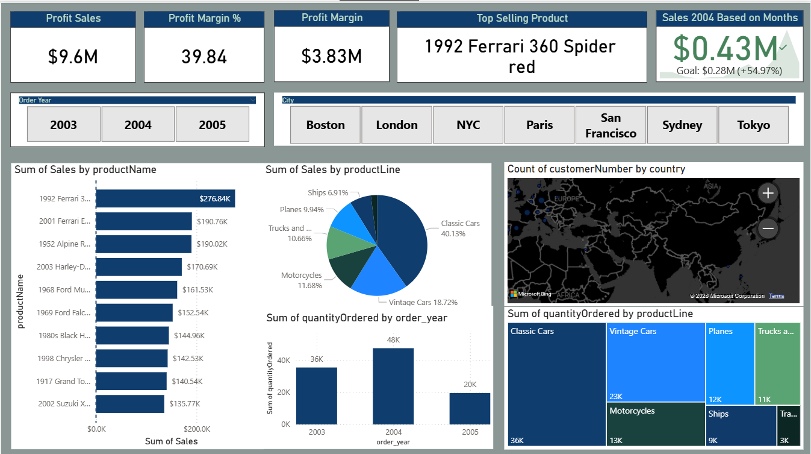
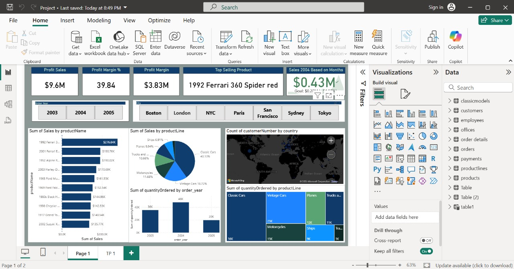
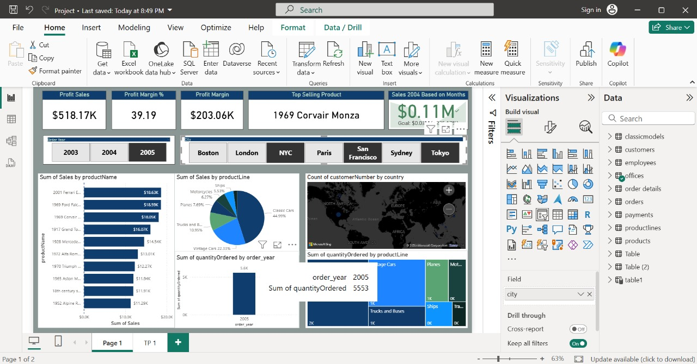
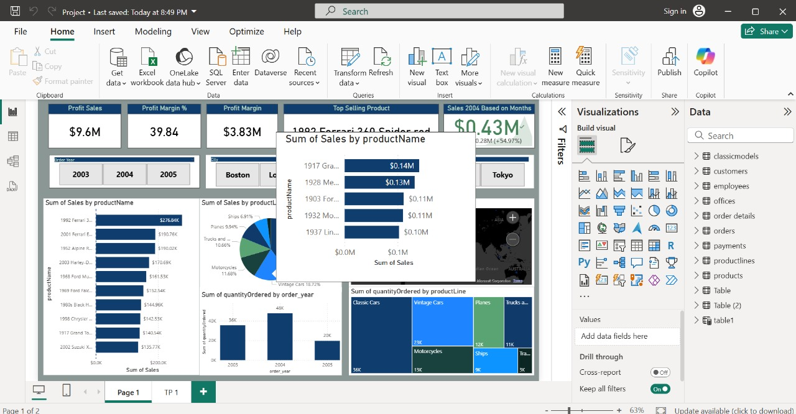
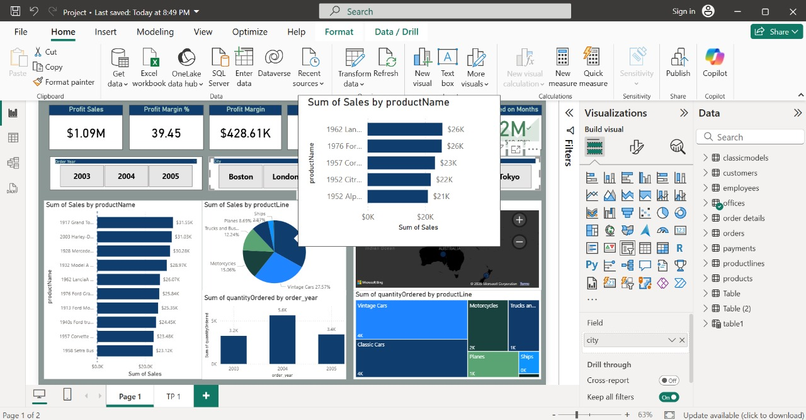
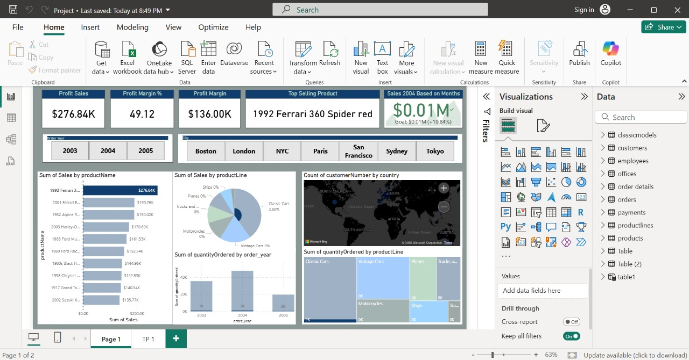
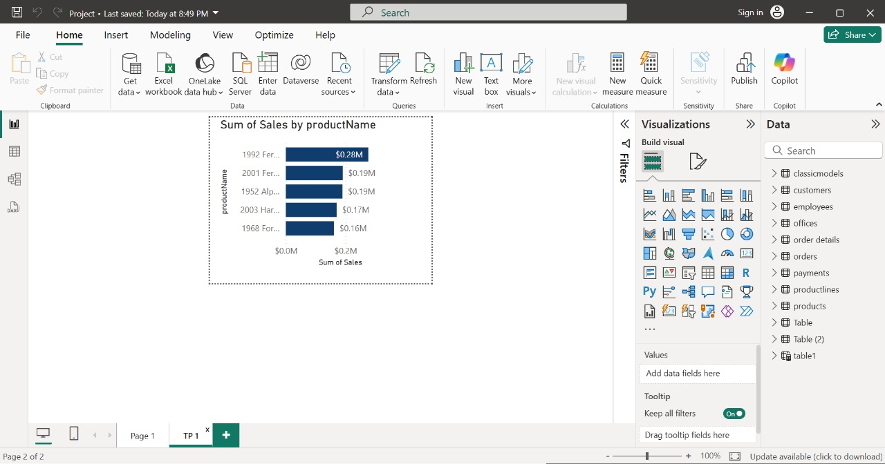

# Profit Analysis Power BI Dashboard: Global Sales & Profit Intelligence 📊🚗



An interactive, end-to-end Power BI dashboard built to analyze global sales performance, profit margins, order volume, and top-performing products from **2003 to 2005**.

---

## 📌 Key Business Insights
* **Total Sales:** \$9.6M
* **Total Profit:** \$3.83M (**39.84%** Profit Margin)
* **Top-Performing Product:** *1992 Ferrari 360 Spider red* (**\$276.84K** in sales | **49.12%** margin)
* **Best Product Category:** *Classic Cars* (**40.15%** share of total revenue)
* **Global Reach:** Tracks performance across 7 global office branches—Boston, London, NYC, Paris, San Francisco, Sydney, and Tokyo.

---

## 🏗️ Data Modeling & Architecture
* **Relational Snowflake Schema:** Connected 8 core tables (`orders`, `orderdetails`, `products`, `productlines`, `customers`, `employees`, `offices`, and `payments`) using `One-to-Many (1:*)` active relationships.
* **Data Transformation & Enrichment:**
  * Created **Calculated Columns** for `Sales`, `Profit`, `order_year`, `Month Name`, `Day Name`, and customer/employee `Full Name`.
  * Organized **DAX Measures** into dedicated measure tables (`Table`, `Table (2)`, `table1`) to keep the model clean and scalable.

---

## ✨ Interactive Features
* **Dynamic Slicers:** Filter the entire dashboard by **Order Year** (2003–2005) and **Office City**.
* **Custom Report Page Tooltips (`TP 1`):** Hover over visuals to dynamically drill down into top-performing products and revenue breakdowns.
* **Cross-Filtering:** Click on any product, category, or region to isolate its individual sales, profit, and order metrics across all visuals.

---

## 📸 Dashboard Previews

### 1. Executive Dashboard Overview (Workspace View)


### 2. Order Year Breakdown (2005 Analysis)


### 3. Custom Tooltip: Top Products Overview


### 4. Custom Tooltip: Filtered Sales View


### 5. Product Cross-Filtering (1992 Ferrari 360 Spider Red)


### 6. Report Page Tooltip Design (`TP 1`)


---

## 🗂️ Repository Structure
```text
PowerBI-Sales-Profit-Intelligence/
├── classic_models_dataset/   # Raw CSV data files (8 relational tables)
├── dashboard_screenshots/    # High-resolution dashboard & tooltip previews
├── Project.pbix              # Complete Power BI Desktop report & data model
└── README.md                 # Project documentation & key insights
```

---

## 🛠️ Tools & Skills Used
* **Power BI Desktop** (Snowflake Schema Data Modeling, Interactive Visuals & Slicers)
* **Power Query** (Data extraction, cleaning, and transformation from CSV files)
* **DAX** (Custom Measures, Calculated Columns, KPI & Profit Margin calculations)
* **Report Page Tooltips** (Custom hover-over drilldown pages)
